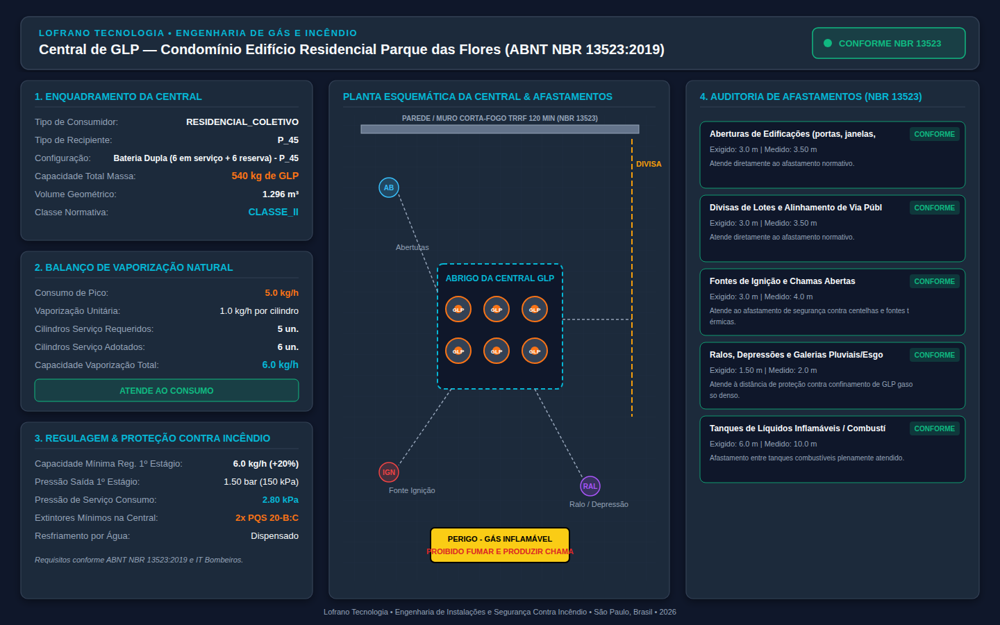
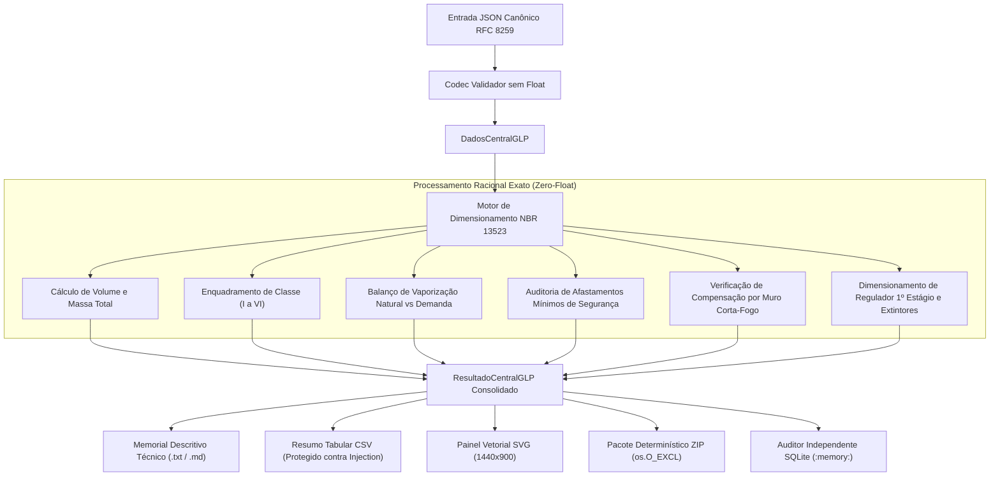

# dimensionamento-central-glp-nbr13523

[](https://github.com/martinlofranodeoliveira/dimensionamento-central-glp-nbr13523/actions/workflows/ci.yml)
[](https://www.python.org/)
[](https://opensource.org/licenses/MIT)
[](https://www.abnt.org.br/)
[](https://github.com/martinlofranodeoliveira)

Motor determinístico de engenharia para projeto, dimensionamento e auditoria de **Centrais de Gás Liquefeito de Petróleo (GLP)** em estrita conformidade com a norma técnica **ABNT NBR 13523:2019** (*Central de gás liquefeito de petróleo - GLP*) e as Instruções Técnicas regulamentares do Corpo de Bombeiros Militar para processos de licenciamento (AVCB / CLCB).

Desenvolvido segundo as diretrizes de integridade e excelência da **Lofrano Tecnologia**, o motor adota **Zero-Float inegociável** (aritmética estritamente racional via `fractions.Fraction` e inteiros), proteção contra injeção de fórmulas CSV, codecs JSON canônicos conforme RFC 8259, gerador de painéis técnicos vetoriais SVG (1440x900) e auditor independente em SQLite desacoplado.

---



---

## 1. Fundamentação Normativa e Engenharia (ABNT NBR 13523:2019)

A norma ABNT NBR 13523:2019 fixa os requisitos mínimos de projeto, montagem, alteração, localização e segurança das centrais de GLP abastecidas por recipientes transportáveis ou estacionários com capacidade volumétrica total de até $64{,}80\text{ m}^3$.

### 1.1 Balanço de Vaporização Natural e Recipientes Padronizados

Para garantir que a central supra continuamente os queimadores sem congelamento dos recipientes ou queda drástica de pressão, a taxa total de vaporização natural da bateria em serviço deve superar a demanda de consumo simultâneo de pico:

$$Q_{\text{vap\_total}} = N_{\text{serviço}} \cdot q_{\text{vap\_unitário}} \ge Q_{\text{pico}}$$

| Tipo de Recipiente | Capacidade Nominal | Volume Geométrico | Taxa Nominal de Vaporização Contínua a 20°C ($q_{\text{vap}}$) |
|---|---|---|---|
| **P-13** | $13\text{ kg}$ | $0{,}031\text{ m}^3$ ($31\text{ L}$) | $0{,}35\text{ kg/h}$ |
| **P-20** | $20\text{ kg}$ | $0{,}048\text{ m}^3$ ($48\text{ L}$) | $0{,}50\text{ kg/h}$ |
| **P-45** | $45\text{ kg}$ | $0{,}108\text{ m}^3$ ($108\text{ L}$) | $1{,}00\text{ kg/h}$ |
| **P-90** | $90\text{ kg}$ | $0{,}216\text{ m}^3$ ($216\text{ L}$) | $2{,}00\text{ kg/h}$ |
| **P-190** | $190\text{ kg}$ | $0{,}456\text{ m}^3$ ($456\text{ L}$) | $3{,}50\text{ kg/h}$ |
| **E-500** | $500\text{ kg}$ | $1{,}200\text{ m}^3$ ($1200\text{ L}$) | $12{,}0\text{ kg/h}$ |
| **E-1000** | $1000\text{ kg}$ | $2{,}400\text{ m}^3$ ($2400\text{ L}$) | $20{,}0\text{ kg/h}$ |
| **E-2000** | $2000\text{ kg}$ | $4{,}800\text{ m}^3$ ($4800\text{ L}$) | $35{,}0\text{ kg/h}$ |
| **E-4000** | $4000\text{ kg}$ | $9{,}600\text{ m}^3$ ($9600\text{ L}$) | $60{,}0\text{ kg/h}$ |

> Se a demanda de pico for superior à capacidade física de vaporização natural da bateria permitida no espaço do lote, torna-se obrigatória a instalação de **Vaporizador Artificial / Forçado** com controle térmico e de nível conforme Item 6 da NBR 13523.

### 1.2 Classificação da Central por Volume Total (Tabelas 1 e 2)

O enquadramento da central é definido pelo volume geométrico total da soma de todos os recipientes (em serviço + reserva):

| Classe | Faixa de Volume Geométrico Total ($V$) | Massa Típica de GLP |
|---|---|---|
| **Classe I** | $V \le 0{,}54\text{ m}^3$ | até $225\text{ kg}$ (ex: até 5 P-45 ou 1 P-190) |
| **Classe II** | $0{,}54\text{ m}^3 < V \le 2{,}16\text{ m}^3$ | $226\text{ kg a } 900\text{ kg}$ (ex: até 20 P-45) |
| **Classe III** | $2{,}16\text{ m}^3 < V \le 5{,}40\text{ m}^3$ | $901\text{ kg a } 2.250\text{ kg}$ |
| **Classe IV** | $5{,}40\text{ m}^3 < V \le 16{,}20\text{ m}^3$ | $2.251\text{ kg a } 6.750\text{ kg}$ |
| **Classe V** | $16{,}20\text{ m}^3 < V \le 32{,}40\text{ m}^3$ | $6.751\text{ kg a } 13.500\text{ kg}$ |
| **Classe VI** | $32{,}40\text{ m}^3 < V \le 64{,}80\text{ m}^3$ | $13.501\text{ kg a } 27.000\text{ kg}$ |

### 1.3 Matriz de Afastamentos Mínimos de Segurança (Metros)

Como o GLP no estado gasoso é aproximadamente 1,5 a 2 vezes mais denso que o ar atmosférico, qualquer vazamento tende a se depositar junto ao solo e fluir para galerias, ralos e depressões. A norma fixa distâncias regulamentares inegociáveis:

| Classe | Aberturas em Edificações | Divisa de Lotes / Alinhamento | Fontes de Ignição e Faíscas | Ralos, Galerias e Depressões | Tanques de Inflamáveis |
|---|---|---|---|---|---|
| **Classe I** | $1{,}5\text{ m}$ | $1{,}5\text{ m}$ | $3{,}0\text{ m}$ | $1{,}5\text{ m}$ | $6{,}0\text{ m}$ |
| **Classe II** | $3{,}0\text{ m}$ | $3{,}0\text{ m}$ | $3{,}0\text{ m}$ | $1{,}5\text{ m}$ | $6{,}0\text{ m}$ |
| **Classe III** | $6{,}0\text{ m}$ | $6{,}0\text{ m}$ | $6{,}0\text{ m}$ | $3{,}0\text{ m}$ | $10{,}0\text{ m}$ |
| **Classe IV** | $7{,}5\text{ m}$ | $7{,}5\text{ m}$ | $7{,}5\text{ m}$ | $3{,}0\text{ m}$ | $10{,}0\text{ m}$ |
| **Classe V** | $10{,}0\text{ m}$ | $10{,}0\text{ m}$ | $10{,}0\text{ m}$ | $3{,}0\text{ m}$ | $15{,}0\text{ m}$ |
| **Classe VI** | $15{,}0\text{ m}$ | $15{,}0\text{ m}$ | $15{,}0\text{ m}$ | $3{,}0\text{ m}$ | $15{,}0\text{ m}$ |

### 1.4 Regras de Compensação por Parede / Muro Corta-Fogo (Item 5.3)

A distância direta entre os recipientes de GLP e as divisas de propriedades vizinhas ou aberturas pode ser reduzida até **zero metros** caso seja interposta uma parede resistente ao fogo, desde que atendidos cumulativamente os seguintes critérios:
1. Parede cega de alvenaria maciça ou concreto sem aberturas com **TRRF mínimo de 120 minutos** (conforme NBR 14432).
2. Altura mínima de **$1{,}80\text{ m}$**.
3. A distância de segurança medida pelo **contorno horizontal livre** da parede corta-fogo até o ponto protegido deve ser maior ou igual ao afastamento normativo exigido para a classe.

---

## 2. Arquitetura do Sistema e Fluxo de Execução



---

## 3. Instalação e Requisitos

O pacote utiliza exclusivamente a biblioteca padrão do Python (**Zero Dependências Externas**).

```bash
# Clone o repositório
git clone https://github.com/martinlofranodeoliveira/dimensionamento-central-glp-nbr13523.git
cd dimensionamento-central-glp-nbr13523

# Instalação em modo de desenvolvimento ou limpo
pip install .
```

Requisitos:
- Python 3.11 ou superior (totalmente compatível com Python 3.11, 3.12, 3.13 e 3.14).

---

## 4. Uso via Linha de Comando (CLI)

O executável de linha de comando `central-glp-nbr13523` oferece controle completo sobre cálculos, relatórios técnicos e geração de artefatos.

### 4.1 Dimensionar e Gerar Memorial Técnico Completo

```bash
central-glp-nbr13523 calcular examples/central_edificio_residencial_p45.json
```

### 4.2 Gerar Pacote Determinístico ZIP e Painel SVG

```bash
central-glp-nbr13523 calcular examples/central_edificio_residencial_p45.json \
  --formato svg \
  --saida painel.svg \
  --pacote-zip dist/pacote_central_glp.zip
```

### 4.3 Consultar Catálogo de Parâmetros e Classes

```bash
central-glp-nbr13523 catalogo
```

### 4.4 Gerar Modelo JSON para Preenchimento

```bash
central-glp-nbr13523 gerar-exemplo -o minha_central_glp.json
```

---

## 5. Uso como Biblioteca Python

```python
from fractions import Fraction
from central_glp_nbr13523 import (
    DadosAfastamentosReais,
    DadosCentralGLP,
    DadosEquipamentoConsumo,
    DadosMuroProtecao,
    TipoConsumidor,
    TipoRecipiente,
    TipoRegulagemPressao,
    dimensionar_central_glp,
    gerar_relatorio_central_glp_texto,
)

# 1. Definição da central e dos afastamentos medidos no lote
central = DadosCentralGLP(
    identificacao_projeto="Condomínio Residencial Jardins",
    tipo_consumidor=TipoConsumidor.RESIDENCIAL_COLETIVO,
    tipo_recipiente=TipoRecipiente.P_45,
    recipientes_em_servico=6,
    recipientes_em_reserva=6,
    consumo_pico_kg_h=Fraction(5, 1),  # 5.0 kg/h
    tipo_regulagem=TipoRegulagemPressao.BAIXA_PRESSAO_2_8_KPA,
    responsavel_tecnico="Eng. Martin Lofrano de Oliveira - CREA/SP",
    afastamentos=DadosAfastamentosReais(
        distancia_aberturas_m=Fraction(7, 2),       # 3.5 m (Req Classe II: 3.0 m)
        distancia_divisa_lote_m=Fraction(7, 2),     # 3.5 m (Req Classe II: 3.0 m)
        distancia_fontes_ignicao_m=Fraction(4, 1),  # 4.0 m (Req Classe II: 3.0 m)
        distancia_ralos_depressoes_m=Fraction(2, 1),# 2.0 m (Req Classe II: 1.5 m)
        distancia_tanques_inflamaveis_m=Fraction(10, 1), # 10.0 m (Req: 6.0 m)
    ),
    muro_protecao=DadosMuroProtecao(possui_muro=False),
)

# 2. Execução do dimensionamento e auditoria NBR 13523
resultado = dimensionar_central_glp(central)

print(f"Classe Normativa: {resultado.classe_central.value}")
print(f"Volume Geométrico: {resultado.volume_total_m3} m³")
print(f"Status NBR 13523: {'CONFORME' if resultado.conformidade_geral else 'INCONFORME'}")
print(f"Extintores Mínimos: {resultado.extintores_minimos_qtd}x PQS {resultado.extintores_capacidade_min}")

# 3. Emissão do memorial técnico
memorial = gerar_relatorio_central_glp_texto(resultado)
print(memorial)
```

---

## 6. Auditoria Independente Desacoplada (SQLite)

O projeto inclui ferramenta de auditoria independente (`tools/verify_independent.py`) que **não importa nenhum módulo da aplicação** e utiliza banco de dados em memória (`:memory:`) para validar as relações físicas e normativas:

```bash
python3 tools/verify_independent.py
```

Resultados auditados automaticamente:
- Volume e massa total por combinação de recipientes.
- Classificação exata em Classes I a VI conforme Tabelas 1 e 2 da NBR 13523.
- Balanço térmico de vaporização natural contínua a 20°C contra demanda simultânea de pico.
- Auditoria de distâncias mínimas para aberturas, divisas de lote, fontes de centelha/ignição e ralos/depressões.
- Validação de regras de compensação por muro corta-fogo TRRF $\ge 120\text{ min}$ e altura $\ge 1{,}80\text{ m}$.

---

## 7. Garantias de Qualidade e Segurança

- **Zero-Float Engine**: Inexistência de ponto flutuante IEEE-754 em cálculos geométricos e dimensionais.
- **Proteção contra Injeção em Planilhas**: O exportador CSV sanitiza qualquer campo iniciado por `=`, `+`, `-`, `@`, `\t` ou `\r`.
- **Determinismo ZIP com `os.O_EXCL`**: Prevenção ativa de sobrescrita acidental e carimbo de data fixado em `2026-01-01 00:00:00`.
- **Multiplataforma CI**: Testes contínuos em Ubuntu (Python 3.11, 3.12, 3.13 e 3.14) e Windows (Python 3.14).
- **Isolamento de Rede**: Verificação com `unshare -r -n` para garantir execução 100% offline.

---

## 8. Licença

Distribuído sob a licença **MIT**. Consulte o arquivo [LICENSE](LICENSE) para mais detalhes.

---
**Lofrano Tecnologia** • Engenharia de Instalações e Segurança Contra Incêndio • São Paulo, Brasil • 2026
